<!--
  README.md · MacJi · Created: 2026-11-26
  Pitch, install, first launch, permissions, usage and building from source.
-->

<p align="center">
  
</p>

<h1 align="center">MacJi</h1>

<p align="center"><b>Emoji anywhere you type.</b> Type <code>::rocket</code> in any Mac app, press Return, and it becomes 🚀.
<code>##arrow</code> gives →, and <code>^_</code> suggests ^_^.</p>

<p align="center">
  <a href="https://github.com/mayank-devac/MacJi/releases/latest"></a>
  
  
  <a href="LICENSE"></a>
</p>

<p align="center">
  <a href="https://github.com/mayank-devac/MacJi/releases"></a>
  <a href="https://github.com/mayank-devac/MacJi/releases/latest"></a>
  
</p>

<p align="center">
  <a href="https://github.com/mayank-devac/MacJi/releases/latest">Download</a> ·
  <a href="#first-launch">First launch</a> ·
  <a href="#usage">Usage</a> ·
  <a href="PRIVACY.md">Privacy</a>
</p>

<p align="center">
  <picture>
    <source media="(prefers-color-scheme: dark)" srcset="assets/screenshots_by_agent/inline-panel-dark.gif">
    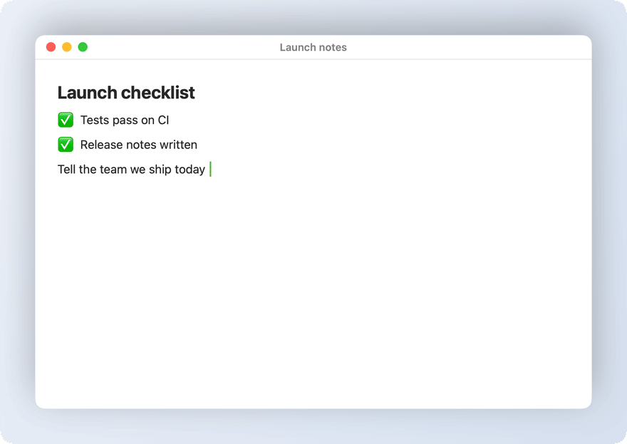
  </picture>
</p>

MacJi is a small, free, open-source menu-bar app for macOS 14.6 or later. It has no Dock icon, no
account and no analytics.

## Features

- **Inline panel.** Type the trigger (`::` by default) and a word in any app. A panel of matching
  emoji opens under the caret. Return replaces `::roc` with the emoji, Shift-Return copies it, Esc
  closes the panel. Keep typing a space or punctuation and it gets out of your way.
- **Symbol panel.** `##arrow` gives → ← ↔, `##euro` €, `##cmd` ⌘. More than 2,000 arrows, math
  and Greek letters, currency, punctuation, shapes and Mac keys, with a category bar that Tab
  cycles and the code point in the footer.
- **Emoticons.** Start typing one, `^_` or `o_`, and MacJi suggests ^_^, (^_^;) or o_O. Over 450
  ASCII emoticons and kaomoji. Choose how many characters it waits for, set a trigger such as `;;`
  to search them by name (`;;shrug` → ¯\_(ツ)_/¯), or turn it off.
- **Learns your favourites.** The panels put what you use most at the top of their matches, so
  `::h` offers your usual ❤️ before 🏠.
- **Aliases.** Type `->` and get →, `!=` gives ≠, `(c)` gives ©, `:)` gives 🙂, in any app, as you
  type. 15 symbols and 28 emoticons in close to 90 spellings, each of which you can turn off.
- **Your own aliases.** Add your own: a name, any number of spellings and any number of outputs,
  such as `[x]` or `(v)` → ✓ ✔ ☑. Typing a spelling gives the first output, and searching the name
  in any panel or the picker (`::check`) shows them all.
- **Emoji picker.** Click the menu-bar icon or press **⌃⌥⌘Space** from any app. Search, browse by
  category or pick from your recents with the keyboard alone, on the Emoji, Symbols and Emoticons
  tabs. If the icon is hidden, the picker opens at your caret, or at the pointer when the app
  doesn't report a caret.
- **Every feature has a switch.** Each panel, emoticon suggestions, aliases, alias search and the
  picker's extra tabs can be turned off on their own. With all typing features off, MacJi doesn't
  watch the keyboard at all.
- **Shared recents.** What you insert inline and what you copy from the picker go into one list.
- **Tells you when it can't work.** When a password field or another app turns on Secure Input,
  macOS hides every keystroke from every app. MacJi says which app is holding it and how to release
  it, rather than failing silently.
- **Updates itself** with Sparkle. Every update is checked against MacJi's EdDSA signature before it
  installs.
- **Feedback without an account.** Send a bug or an idea from Settings by email or as a GitHub
  issue, with only the technical details you choose to include.

## Install

1. Download `MacJi-<version>.dmg` from [Releases](https://github.com/mayank-devac/MacJi/releases/latest).
2. Open it and drag **MacJi** into **Applications**.
3. Open MacJi. The first time, macOS will block it; see [First launch](#first-launch).

A Homebrew cask is planned.

## First launch

MacJi is signed with its own certificate, but it isn't notarized by Apple, because that needs a paid
developer account. The first time you open it, macOS says it can't verify MacJi. To allow it once:

1. Open MacJi from Applications and dismiss the warning (choose **Done**, not **Move to Trash**).
2. Open **System Settings → Privacy & Security** and scroll to **Security**.
3. Next to *"MacJi" was blocked to protect your Mac*, click **Open Anyway**, then confirm with your
   password or Touch ID.

macOS remembers this choice, so updates open normally afterwards.

**Prefer to check the download first?** Each release lists SHA-256 sums in `SHA256SUMS.txt`:

```sh
shasum -a 256 ~/Downloads/MacJi-*.dmg
```

If the sum matches and you'd rather use Terminal than System Settings, this clears the download
flag in one step:

```sh
xattr -dr com.apple.quarantine /Applications/MacJi.app
```

## Permissions

MacJi asks for one permission: **Accessibility**. Settings shows its status and a **Grant Access…**
button that opens the right System Settings pane with a short drag-to-allow guide.

| | |
|---|---|
| **Why it's needed** | The inline panel has to notice when you type the trigger, find the caret so the panel opens beside it, and type the emoji in place of `::roc`. macOS only allows that with Accessibility access. |
| **What it reads** | Key presses, only while the inline panel is turned on. They're matched against the trigger and the aliases in memory, and only the last few characters are kept. |
| **What it never does** | Store, log or send keystrokes. Read the text of your documents. Run in the background with the inline panel turned off: switching it off removes the keyboard listener completely. |
| **What works without it** | The emoji picker. Its shortcut and clipboard copy don't need any permission. |

If you remove MacJi's Accessibility access while it's running, MacJi detects it, stops listening at
once and restarts, so your keyboard never gets stuck.

## Usage

### Inline panel

| Key | Action |
|---|---|
| `::` + word | Open the panel with matching emoji (`::heart`, `::thumbs`, `::roc`) |
| ← ↑ → ↓ | Move the selection |
| Return | Replace `::word` with the selected emoji |
| Shift-Return | Copy the emoji and leave your text as it is |
| Esc | Close the panel |
| Space, punctuation | Close the panel and keep typing |

The trigger never fires right after a letter or digit, so code like `std::string` won't open it.

### Symbol panel

<p align="center">
  <picture>
    <source media="(prefers-color-scheme: dark)" srcset="assets/screenshots_by_agent/symbol-panel-dark.gif">
    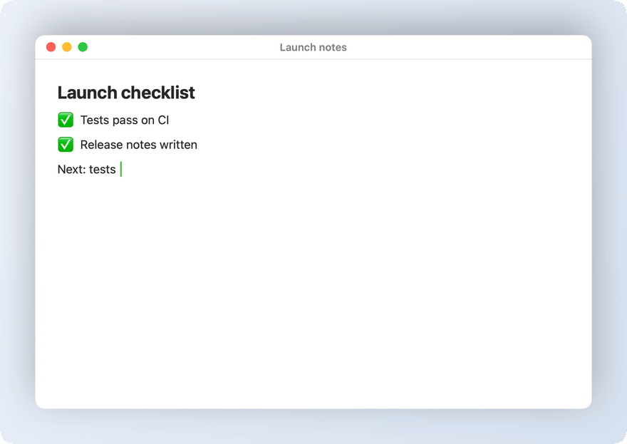
  </picture>
</p>

Type `##` and a word: `##arrow`, `##rarr`, `##euro`, `##sum`, `##cmd`, `##check`. The keys are the
same as the emoji panel's, plus **Tab / Shift-Tab** to step through the categories (Arrows, Math,
Greek, Currency, Punctuation, Letterlike, Numbers, Shapes, Signs, Technical). Names come from
Unicode and also match common short names such as `rarr`, `ne`, `inf`, `deg` and `opt`. `## Heading`
(with a space) and `a##b` never open it. Change the trigger in Settings › Inline Panels.

### Emoticons

<p align="center">
  <picture>
    <source media="(prefers-color-scheme: dark)" srcset="assets/screenshots_by_agent/emoticon-panel-dark.gif">
    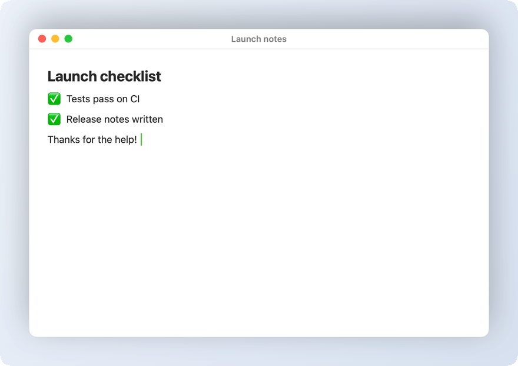
  </picture>
</p>

Type the start of an emoticon and the Emoticons panel suggests the rest: `^_` → ^_^ ^_~, `o_` → o_O,
`(^` → (^_^) (^_^;), `:-` → :-) :-( :-P. Return inserts the selection in place of what you typed.

- It waits for 2 typed characters by default (change it with **− +** in Settings › Emoticons, or
  set it to Off), and what you typed must include a symbol, so ordinary words never match.
- Starts that are common in code and markup, such as `--`, `//`, `==`, `((`, `>=` and `</`, never
  open it, so an open suggestion never takes your Return or Esc there.
- Esc closes it for the rest of that word.
- Set a **trigger** such as `;;` to search all emoticons by name: `;;shrug` → ¯\_(ツ)_/¯,
  `;;flip` → (╯°□°)╯︵┻━┻. It's blank (off) by default.

ASCII emoticons come from [wooorm/emoticon](https://github.com/wooorm/emoticon) and kaomoji from
[netromdk/kaomojidict](https://github.com/netromdk/kaomojidict), both MIT, minus a few that mock
companies or threaten.

#### Ranking

Matches are ordered by how well they fit what you typed: an exact short name (`::fire` → 🔥)
first, then short names that start with it, then names and keywords with a word that starts with
it, then names that only contain it. With several words, every word must match.

With **Rank frequently used first** on (the default), emoji you have inserted or copied
before jump ahead of that order, most used first, whenever a short name or a word of their name
or keywords starts with what you typed. MacJi counts uses on your Mac only. Turn the setting off
to get the plain order back. The picker keeps the plain order.

### Aliases (symbol conversion)

<p align="center">
  <picture>
    <source media="(prefers-color-scheme: dark)" srcset="assets/screenshots_by_agent/aliases-dark.gif">
    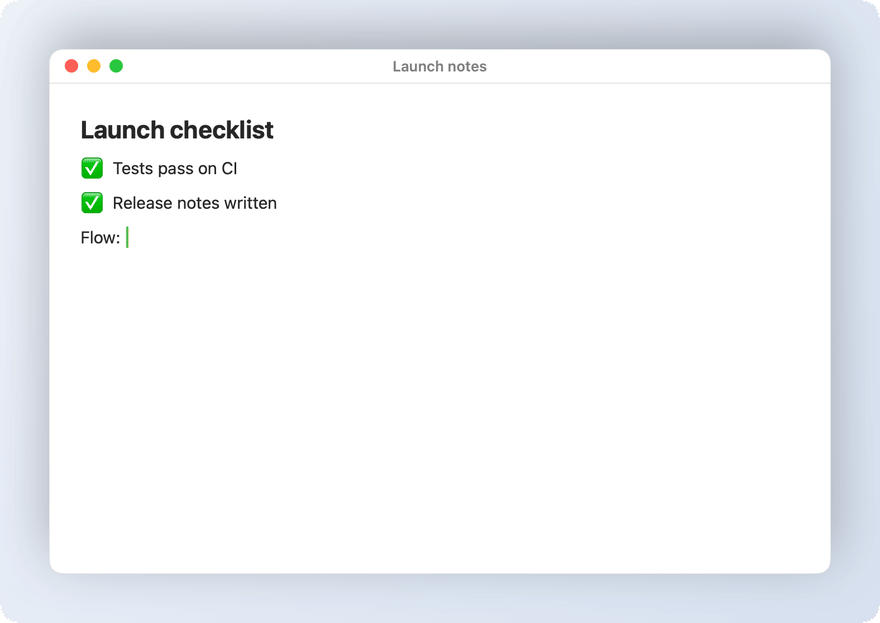 ship ... != (c) turns into build → ship … ≠ © as each alias completes">
  </picture>
</p>

With **Aliases** on (the default), MacJi converts a short spelling into a symbol or emoji the
moment you type its last character, in every app where the inline panel works. Delete right
after a conversion removes the symbol.

| Group | You type | You get |
|---|---|---|
| Arrows | `->` `<-` `<->` `=>` `<==` `<=>` | → ← ↔ ⇒ ⇐ ⇔ |
| Math | `!=` `<=` `>=` `+-` `~=` | ≠ ≤ ≥ ± ≈ |
| Symbols | `...` `(c)` `(r)` `(tm)` | … © ® ™ |
| Emoticons (off until you turn them on) | `:)` `:D` `;)` `:P` `:(` `:'(` `>:(` `<3` … | 🙂 😃 😉 😛 🙁 😢 😠 ❤️ … |

- Bracket symbols and emoticons convert only after a space or at the start of a line, so
  `note:)`, `f(c)` and the `::` trigger stay as typed.
- Longer spellings build on shorter ones: `<->` becomes ↔ even though `<-` converts first.
- Settings › Aliases › **Customize…** has a switch for every alias and every group, and a filter.
  Turn off the ones you type in code, such as `->` or `!=`, or hide one you never want to see
  (**Show Hidden** brings them back). The emoticon aliases start off; every other group starts on.
  Aliases work whether or not the panels are on.
- The emoticon spellings come from [wooorm/emoticon](https://github.com/wooorm/emoticon),
  minus the ones that would fire inside words, lists, URLs or code.

#### Your own aliases

<p align="center">
  <picture>
    <source media="(prefers-color-scheme: dark)" srcset="assets/screenshots_by_agent/aliases-page-dark.png">
    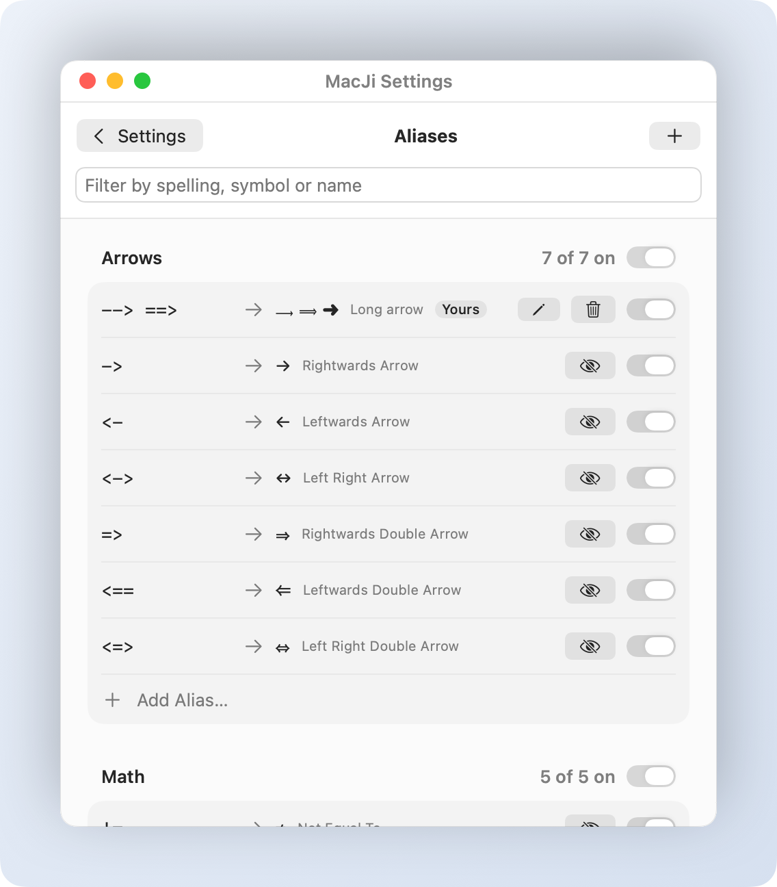
  </picture>
  <picture>
    <source media="(prefers-color-scheme: dark)" srcset="assets/screenshots_by_agent/alias-editor-dark.png">
    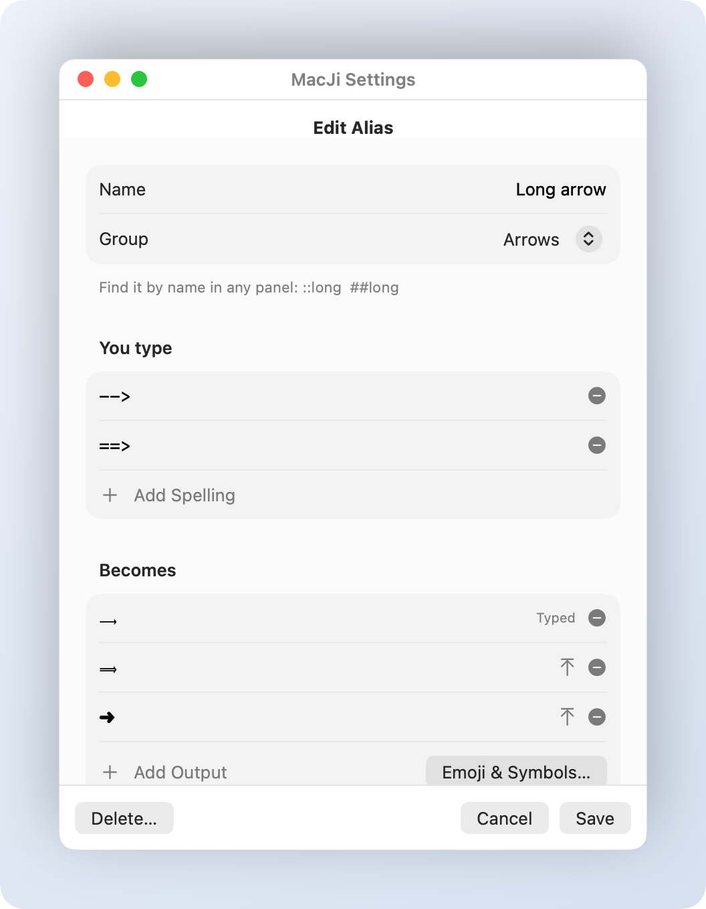 and ==>, outputs ⟶ ⟹ ➜ with the first marked Typed">
  </picture>
</p>

On the Aliases page, click **+** (or **Add Alias…** in a group) and fill in:

- **Name**: what search finds. Name it "Check mark" and `::check`, `##check` or the picker shows
  its outputs, listed first.
- **You type**: one or more spellings, each 2–16 characters with at least one symbol, so they never
  fire inside a word. **Add Spelling** adds another.
- **Becomes**: one or more outputs, up to 64 characters each: a symbol, an emoji, an emoticon or a
  short text. The first is typed; **Add Output** adds more for search, and the arrow button makes
  another one the typed output. **Emoji & Symbols…** opens the Character Viewer.
- **Only after a space or at the start of a line** (on by default) keeps `note[x]` and code as typed.

The pencil beside an alias's switch edits it; the trash button deletes it.

A spelling of yours that a built-in alias also uses replaces it while yours is on. Turn off
**Show your aliases in search** to keep them out of search.

[docs/convert-symbols.md](docs/convert-symbols.md) lists every alias, the common conversions
left out and why, and how to type each symbol on a Mac without MacJi.

### Emoji picker

<p align="center">
  <picture>
    <source media="(prefers-color-scheme: dark)" srcset="assets/screenshots_by_agent/picker-dark.png">
    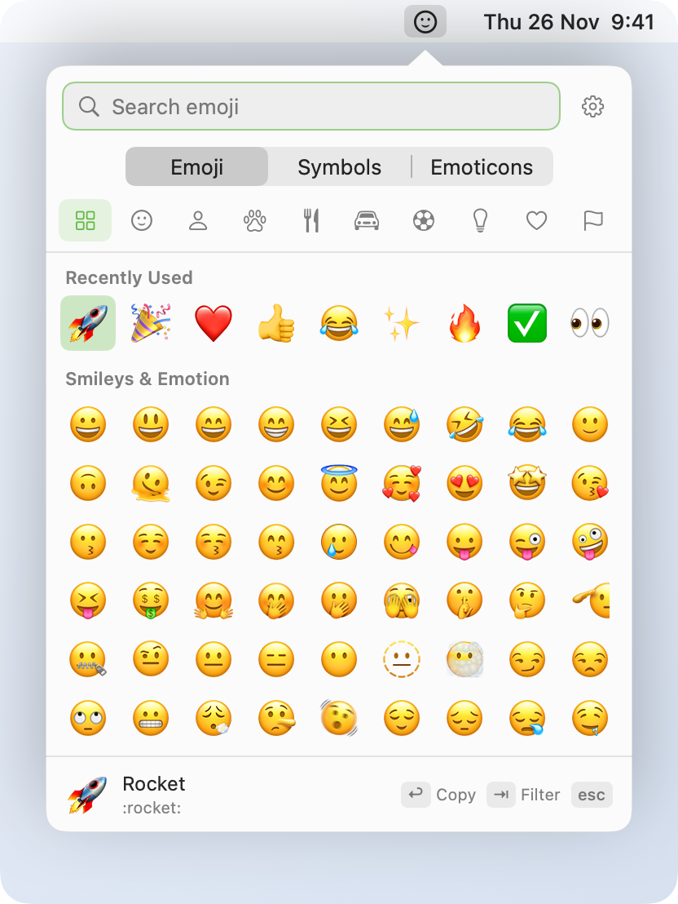
  </picture>
  <picture>
    <source media="(prefers-color-scheme: dark)" srcset="assets/screenshots_by_agent/picker-search-dark.png">
    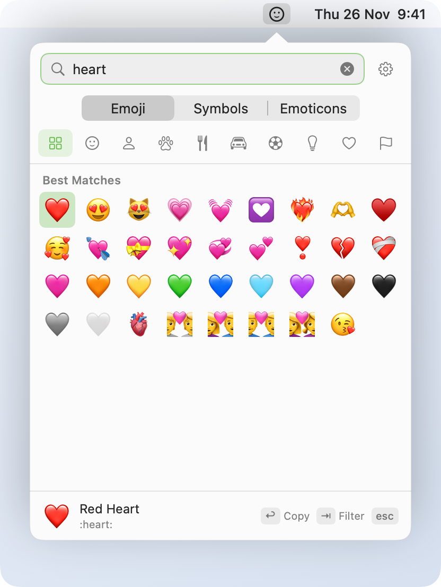
  </picture>
</p>
<p align="center">
  <picture>
    <source media="(prefers-color-scheme: dark)" srcset="assets/screenshots_by_agent/picker-symbols-dark.png">
    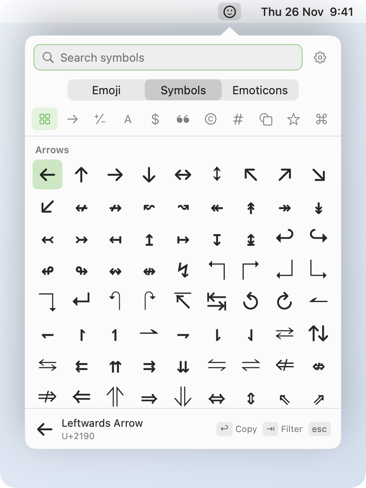
  </picture>
  <picture>
    <source media="(prefers-color-scheme: dark)" srcset="assets/screenshots_by_agent/picker-emoticons-dark.png">
    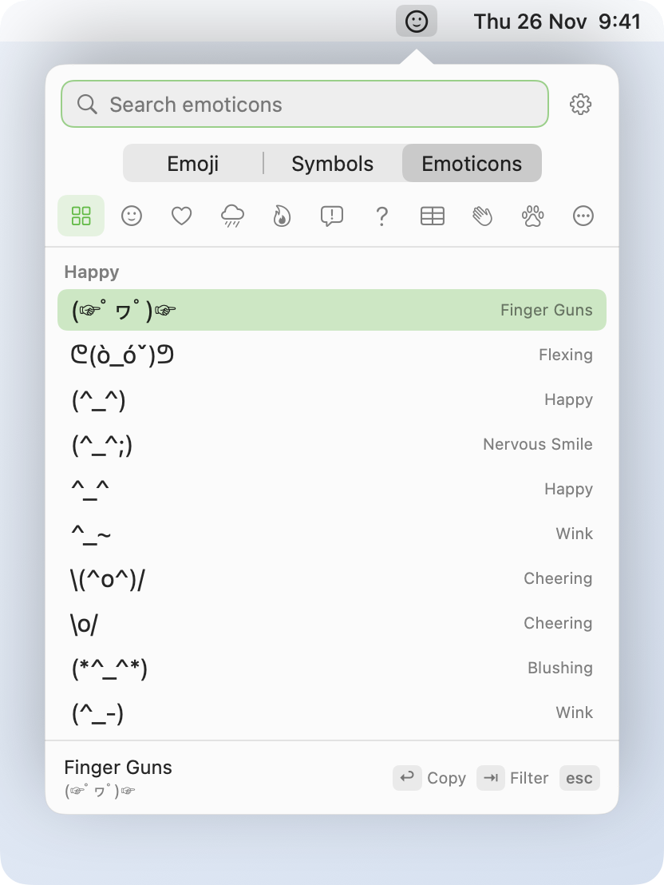
  </picture>
</p>

| Key | Action |
|---|---|
| ⌃⌥⌘Space or the menu-bar icon | Open the picker |
| Type | Search by name or keyword |
| ← ↑ → ↓ | Move the selection |
| Tab / Shift-Tab | Next / previous category |
| ⌘1 ⌘2 ⌘3 | Emoji, Symbols or Emoticons tab |
| Return | Copy the emoji and close |
| Option-Return | Copy the emoji and keep the picker open |
| Esc | Clear the search, then close |

Right-click the menu-bar icon for Settings, Check for Updates and Quit.

## Settings

<p align="center">
  <picture>
    <source media="(prefers-color-scheme: dark)" srcset="assets/screenshots_by_agent/settings-dark.png">
    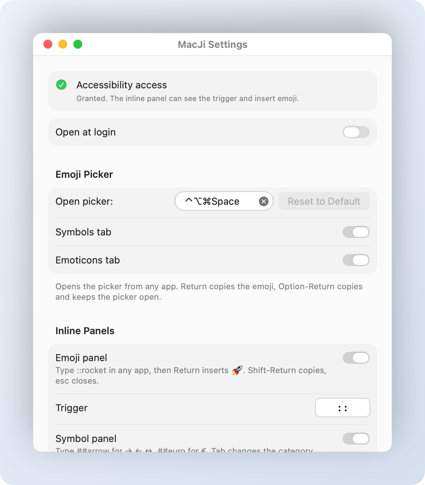
  </picture>
</p>

MacJi opens Settings the first time it runs. Open it again from the menu-bar icon's right-click menu,
or open MacJi again from Applications or Spotlight, which also works when the icon is hidden.

- **Accessibility:** status, Grant Access, and a warning while Secure Input is on. Below it,
  **Open at login**.
- **Emoji Picker:** record a different shortcut, or reset it to ⌃⌥⌘Space. Show or hide the
  Symbols and Emoticons tabs.
- **Inline Panels:** turn the emoji and symbol panels on or off and change their triggers (up to
  four characters, with a symbol such as `:` or `#` so they never fire inside ordinary words; no
  trigger may contain another). Turn frequency ranking on or off.
- **Emoticons:** turn emoticons on or off, set how many characters **Suggest as you type** waits
  for (or Off), and set an optional trigger.
- **Aliases:** turn conversion on or off, show or hide your aliases in search, and open
  **Customize…** to switch, hide or add aliases.
- **Menu Bar:** show or hide the icon.
- **Updates:** automatic update checks, Check Now.
- **About:** version, links, and **Send Feedback…** (see [Feedback](#feedback)).

Your settings, recents, shortcut and Accessibility access all carry over when MacJi updates.

## Updates

MacJi checks for updates once a day with [Sparkle](https://sparkle-project.org). You can turn that
off in Settings and check by hand from the menu-bar icon instead. Updates come over HTTPS from
GitHub, and Sparkle installs one only if its EdDSA signature matches the key built into MacJi. This
update check is the only network request MacJi makes.

## Build from source

You need Xcode 16 or later (MacJi is developed with Xcode 27) and macOS 15 or later to run the tests.

```sh
git clone https://github.com/mayank-devac/MacJi.git
cd MacJi
scripts/setup.sh     # checks Xcode, fetches packages, creates Config/LocalSigning.xcconfig
./build.sh           # builds Debug, quits the running build and launches the new one
scripts/test.sh      # runs the tests
```

Debug builds use a separate bundle ID (`…macji.debug`), so they never share settings or permissions
with an installed MacJi. They're signed ad-hoc by default, which makes macOS forget the Accessibility
grant after each rebuild. Set a signing identity in `Config/LocalSigning.xcconfig` to keep it. When
the signature changes between builds, `./build.sh` offers to reset the old grant so you can allow
the new build with one switch.

Releases are built by `scripts/release.py`; see [docs/RELEASING.md](docs/RELEASING.md). How the code
fits together is in [docs/ARCHITECTURE.md](docs/ARCHITECTURE.md).

## Feedback

<p align="center">
  <picture>
    <source media="(prefers-color-scheme: dark)" srcset="assets/screenshots_by_agent/feedback-dark.png">
    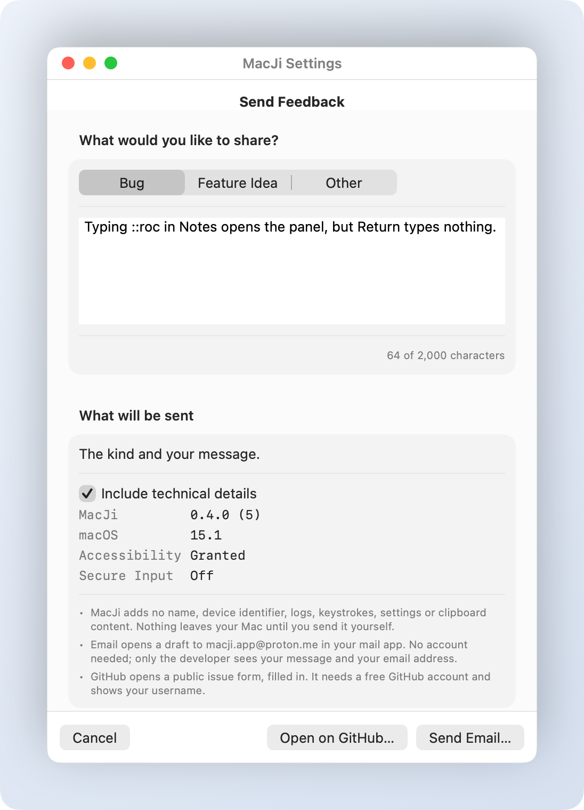
  </picture>
</p>

**Settings › About › Send Feedback…** opens a short form: pick Bug, Feature Idea or Other and write
your message. Tick **Include technical details** to add the MacJi and macOS versions and whether
Accessibility is granted and Secure Input is on. The form shows exactly what will be sent, and
MacJi never adds anything else: no name, device identifier, logs, keystrokes or settings.

- **Send Email…** opens a draft to [macji.app@proton.me](mailto:macji.app@proton.me) in your mail
  app (Apple Mail unless you chose another). If your default email reader is a browser, it opens
  Gmail's compose page instead, already filled in. Only the developer sees it.
- **Open on GitHub…** opens the matching issue form, filled in. It's public and needs a free GitHub
  account.

Nothing leaves your Mac until you press Send in your mail app or submit the issue. Your text stays
in the form until you press Done, and the form names the app the draft opened in. If it arrives
empty, **Copy Message** and paste it in.

No MacJi at hand? The [feedback page](https://mayank-devac.github.io/MacJi/feedback.html) on the
website does the same: pick how MacJi feels and the kind, write your message, and it opens the
draft in your mail app, in Gmail (**Compose in Gmail**) or as a filled-in GitHub issue. A face made of dots wears the mood you pick and
reads along as you type. The page stores and sends nothing.

## Contributing

Bug reports, ideas and pull requests are welcome; [Feedback](#feedback) is the quickest way to
report something. See [CONTRIBUTING.md](CONTRIBUTING.md). For a security problem, follow
[SECURITY.md](SECURITY.md) instead of opening a public issue.

## Privacy

MacJi has no analytics, no crash reporting and no account. It stores your settings, your own
aliases, your recent emoji, symbols and emoticons and how often you used each one on your Mac, and
nothing else. The details are in [PRIVACY.md](PRIVACY.md).

## Built on Octopus

MacJi started as a feature of [Octopus](https://github.com/mayank-devac/octopus-mac), a macOS window
sidebar and snapping app. The emoji panel and picker grew popular enough to deserve an app of their
own. Octopus is linked as a reference at [`Upstream/octopus`](Upstream/octopus); MacJi keeps its own
copies of that code, so a change in Octopus can never break the MacJi build.

## Licence

MacJi is released under the [MIT Licence](LICENSE). Emoji data comes from
[gemoji](https://github.com/github/gemoji) (MIT) and emoticon spellings from
[emoticon](https://github.com/wooorm/emoticon) (MIT). Notices for included code and data are in
[LICENSES](LICENSES).
