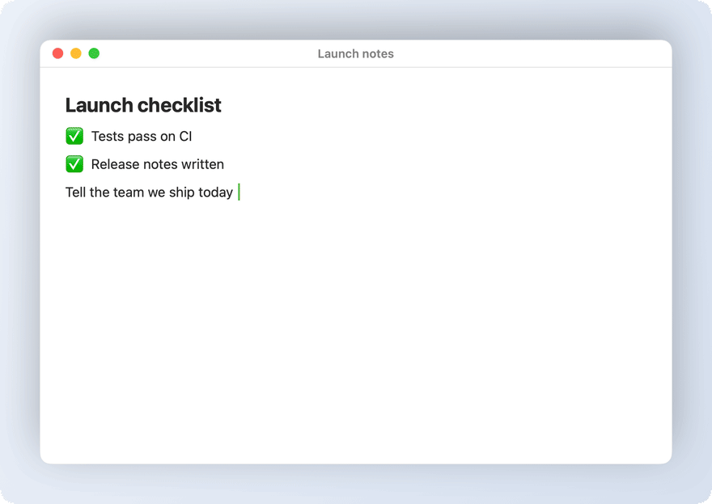
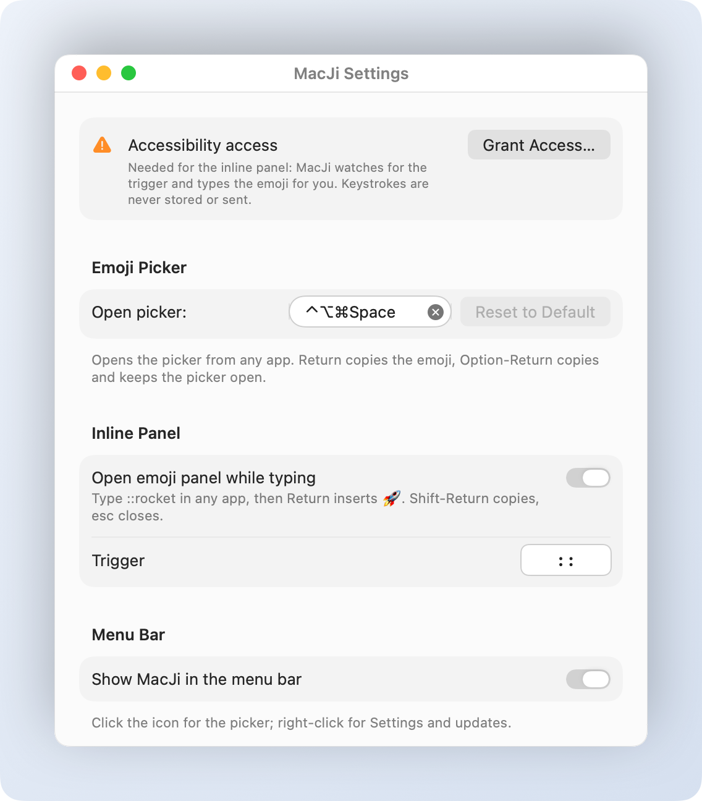

<!--
  README.md · MacJi · Created: 2026-11-26
  Pitch, install, first launch, permissions, usage and building from source.
-->

<p align="center">
  
</p>

<h1 align="center">MacJi</h1>

<p align="center"><b>Emoji anywhere you type.</b> Type <code>::rocket</code> in any Mac app, press Return, and it becomes 🚀.</p>

<p align="center">
  <a href="https://github.com/mayank-devac/MacJi/releases/latest"></a>
  
  
  <a href="LICENSE"></a>
</p>

<p align="center">
  <a href="https://github.com/mayank-devac/MacJi/releases"></a>
  <a href="https://github.com/mayank-devac/MacJi/releases/latest"></a>
  
</p>

<p align="center">
  <a href="https://github.com/mayank-devac/MacJi/releases/latest">Download</a> ·
  <a href="#first-launch">First launch</a> ·
  <a href="#usage">Usage</a> ·
  <a href="PRIVACY.md">Privacy</a>
</p>

<p align="center">
  <picture>
    <source media="(prefers-color-scheme: dark)" srcset="assets/screenshots/inline-panel-dark.gif">
    
  </picture>
</p>

MacJi is a small, free, open-source menu-bar app for macOS 14.6 or later. It has no Dock icon, no
account and no analytics.

## Features

- **Inline panel.** Type the trigger (`::` by default) and a word in any app. A panel of matching
  emoji opens under the caret. Return replaces `::roc` with the emoji, Shift-Return copies it, Esc
  closes the panel. Keep typing a space or punctuation and it gets out of your way.
- **Learns your favourites.** The inline panel puts the emoji you use most at the top of its
  matches, so `::h` offers your usual ❤️ before 🏠.
- **Aliases.** Type `->` and get →, `!=` gives ≠, `(c)` gives ©, `:)` gives 🙂, in any app, as you
  type. 15 symbols and 28 emoticons in close to 90 spellings, each of which you can turn off.
- **Emoji picker.** Click the menu-bar icon or press **⌃⌥⌘Space** from any app. Search, browse by
  category or pick from your recents with the keyboard alone. If the icon is hidden, the picker opens
  at your caret, or at the pointer when the app doesn't report a caret.
- **Shared recents.** Emoji you insert inline and emoji you copy from the picker go into one list.
- **Tells you when it can't work.** When a password field or another app turns on Secure Input,
  macOS hides every keystroke from every app. MacJi says which app is holding it and how to release
  it, rather than failing silently.
- **Updates itself** with Sparkle. Every update is checked against MacJi's EdDSA signature before it
  installs.

## Install

1. Download `MacJi-<version>.dmg` from [Releases](https://github.com/mayank-devac/MacJi/releases/latest).
2. Open it and drag **MacJi** into **Applications**.
3. Open MacJi. The first time, macOS will block it; see [First launch](#first-launch).

A Homebrew cask is planned.

## First launch

MacJi is signed with its own certificate, but it isn't notarized by Apple, because that needs a paid
developer account. The first time you open it, macOS says it can't verify MacJi. To allow it once:

1. Open MacJi from Applications and dismiss the warning (choose **Done**, not **Move to Trash**).
2. Open **System Settings → Privacy & Security** and scroll to **Security**.
3. Next to *"MacJi" was blocked to protect your Mac*, click **Open Anyway**, then confirm with your
   password or Touch ID.

macOS remembers this choice, so updates open normally afterwards.

**Prefer to check the download first?** Each release lists SHA-256 sums in `SHA256SUMS.txt`:

```sh
shasum -a 256 ~/Downloads/MacJi-*.dmg
```

If the sum matches and you'd rather use Terminal than System Settings, this clears the download
flag in one step:

```sh
xattr -dr com.apple.quarantine /Applications/MacJi.app
```

## Permissions

MacJi asks for one permission: **Accessibility**. Settings shows its status and a **Grant Access…**
button that opens the right System Settings pane with a short drag-to-allow guide.

| | |
|---|---|
| **Why it's needed** | The inline panel has to notice when you type the trigger, find the caret so the panel opens beside it, and type the emoji in place of `::roc`. macOS only allows that with Accessibility access. |
| **What it reads** | Key presses, only while the inline panel is turned on. They're matched against the trigger and the aliases in memory, and only the last few characters are kept. |
| **What it never does** | Store, log or send keystrokes. Read the text of your documents. Run in the background with the inline panel turned off: switching it off removes the keyboard listener completely. |
| **What works without it** | The emoji picker. Its shortcut and clipboard copy don't need any permission. |

If you remove MacJi's Accessibility access while it's running, MacJi detects it, stops listening at
once and restarts, so your keyboard never gets stuck.

## Usage

### Inline panel

| Key | Action |
|---|---|
| `::` + word | Open the panel with matching emoji (`::heart`, `::thumbs`, `::roc`) |
| ← ↑ → ↓ | Move the selection |
| Return | Replace `::word` with the selected emoji |
| Shift-Return | Copy the emoji and leave your text as it is |
| Esc | Close the panel |
| Space, punctuation | Close the panel and keep typing |

The trigger never fires right after a letter or digit, so code like `std::string` won't open it.

#### Ranking

Matches are ordered by how well they fit what you typed: an exact short name (`::fire` → 🔥)
first, then short names that start with it, then names and keywords with a word that starts with
it, then names that only contain it. With several words, every word must match.

With **Rank frequently used emoji higher** on (the default), emoji you have inserted or copied
before jump ahead of that order, most used first, whenever a short name or a word of their name
or keywords starts with what you typed. MacJi counts uses on your Mac only. Turn the setting off
to get the plain order back. The picker keeps the plain order.

### Aliases (symbol conversion)

With **Aliases** on (the default), MacJi converts a short spelling into a symbol or emoji the
moment you type its last character, in every app where the inline panel works. Delete right
after a conversion removes the symbol.

| Group | You type | You get |
|---|---|---|
| Arrows | `->` `<-` `<->` `=>` `<==` `<=>` | → ← ↔ ⇒ ⇐ ⇔ |
| Math | `!=` `<=` `>=` `+-` `~=` | ≠ ≤ ≥ ± ≈ |
| Symbols | `...` `(c)` `(r)` `(tm)` | … © ® ™ |
| Emoticons | `:)` `:D` `;)` `:P` `:(` `:'(` `>:(` `<3` … | 🙂 😃 😉 😛 🙁 😢 😠 ❤️ … |

- Bracket symbols and emoticons convert only at the start of a word, so `note:)`, `f(c)` and
  the `::` trigger stay as typed.
- Longer spellings build on shorter ones: `<->` becomes ↔ even though `<-` converts first.
- Settings › Inline Panel › **Customize…** has a switch for every alias. Turn off the ones you
  type in code, such as `->` or `!=`. Aliases added in a later version start on.
- The emoticon spellings come from [wooorm/emoticon](https://github.com/wooorm/emoticon),
  minus the ones that would fire inside words, lists, URLs or code.

[docs/convert-symbols.md](docs/convert-symbols.md) lists every alias, the common conversions
left out and why, and how to type each symbol on a Mac without MacJi.

### Emoji picker

<p align="center">
  <picture>
    <source media="(prefers-color-scheme: dark)" srcset="assets/screenshots/picker-dark.png">
    
  </picture>
  <picture>
    <source media="(prefers-color-scheme: dark)" srcset="assets/screenshots/picker-search-dark.png">
    
  </picture>
</p>

| Key | Action |
|---|---|
| ⌃⌥⌘Space or the menu-bar icon | Open the picker |
| Type | Search by name or keyword |
| ← ↑ → ↓ | Move the selection |
| Tab / Shift-Tab | Next / previous category |
| Return | Copy the emoji and close |
| Option-Return | Copy the emoji and keep the picker open |
| Esc | Clear the search, then close |

Right-click the menu-bar icon for Settings, Check for Updates and Quit.

## Settings

<p align="center">
  <picture>
    <source media="(prefers-color-scheme: dark)" srcset="assets/screenshots/settings-dark.png">
    
  </picture>
</p>

MacJi opens Settings the first time it runs. Open it again from the menu-bar icon's right-click menu,
or open MacJi again from Applications or Spotlight, which also works when the icon is hidden.

- **Accessibility:** status, Grant Access, and a warning while Secure Input is on.
- **Emoji Picker:** record a different shortcut, or reset it to ⌃⌥⌘Space.
- **Inline Panel:** turn it on or off, and change the trigger (up to four characters, with a symbol
  such as `:` or `;` so it never fires inside ordinary words). Turn frequent-emoji ranking on or
  off, turn Aliases on or off, and pick single aliases under **Customize…**.
- **Menu Bar:** show or hide the icon.
- **General:** open at login, automatic update checks, Check Now.

Your settings, recents, shortcut and Accessibility access all carry over when MacJi updates.

## Updates

MacJi checks for updates once a day with [Sparkle](https://sparkle-project.org). You can turn that
off in Settings and check by hand from the menu-bar icon instead. Updates come over HTTPS from
GitHub, and Sparkle installs one only if its EdDSA signature matches the key built into MacJi. This
update check is the only network request MacJi makes.

## Build from source

You need Xcode 16 or later (MacJi is developed with Xcode 27) and macOS 15 or later to run the tests.

```sh
git clone https://github.com/mayank-devac/MacJi.git
cd MacJi
scripts/setup.sh     # checks Xcode, fetches packages, creates Config/LocalSigning.xcconfig
./build.sh           # builds Debug, quits the running build and launches the new one
scripts/test.sh      # runs the tests
```

Debug builds use a separate bundle ID (`…macji.debug`), so they never share settings or permissions
with an installed MacJi. They're signed ad-hoc by default, which makes macOS forget the Accessibility
grant after each rebuild. Set a signing identity in `Config/LocalSigning.xcconfig` to keep it. When
the signature changes between builds, `./build.sh` offers to reset the old grant so you can allow
the new build with one switch.

Releases are built by `scripts/release.py`; see [docs/RELEASING.md](docs/RELEASING.md). How the code
fits together is in [docs/ARCHITECTURE.md](docs/ARCHITECTURE.md).

## Contributing

Bug reports, ideas and pull requests are welcome. See [CONTRIBUTING.md](CONTRIBUTING.md). For a
security problem, follow [SECURITY.md](SECURITY.md) instead of opening a public issue.

## Privacy

MacJi has no analytics, no crash reporting and no account. It stores your settings, your recent
emoji and how often you used each one on your Mac, and nothing else. The details are in [PRIVACY.md](PRIVACY.md).

## Built on Octopus

MacJi started as a feature of [Octopus](https://github.com/mayank-devac/octopus-mac), a macOS window
sidebar and snapping app. The emoji panel and picker grew popular enough to deserve an app of their
own. Octopus is linked as a reference at [`Upstream/octopus`](Upstream/octopus); MacJi keeps its own
copies of that code, so a change in Octopus can never break the MacJi build.

## Licence

MacJi is released under the [MIT Licence](LICENSE). Emoji data comes from
[gemoji](https://github.com/github/gemoji) (MIT) and emoticon spellings from
[emoticon](https://github.com/wooorm/emoticon) (MIT). Notices for included code and data are in
[LICENSES](LICENSES).
